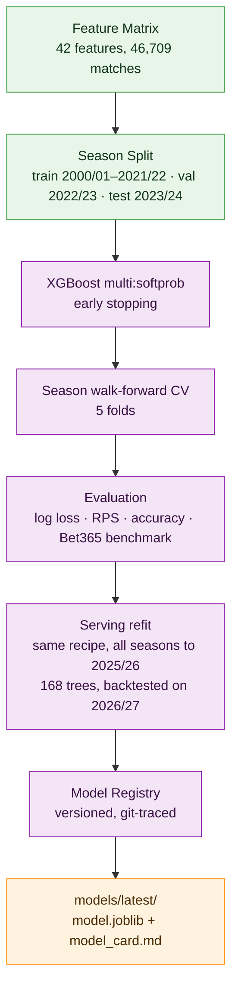
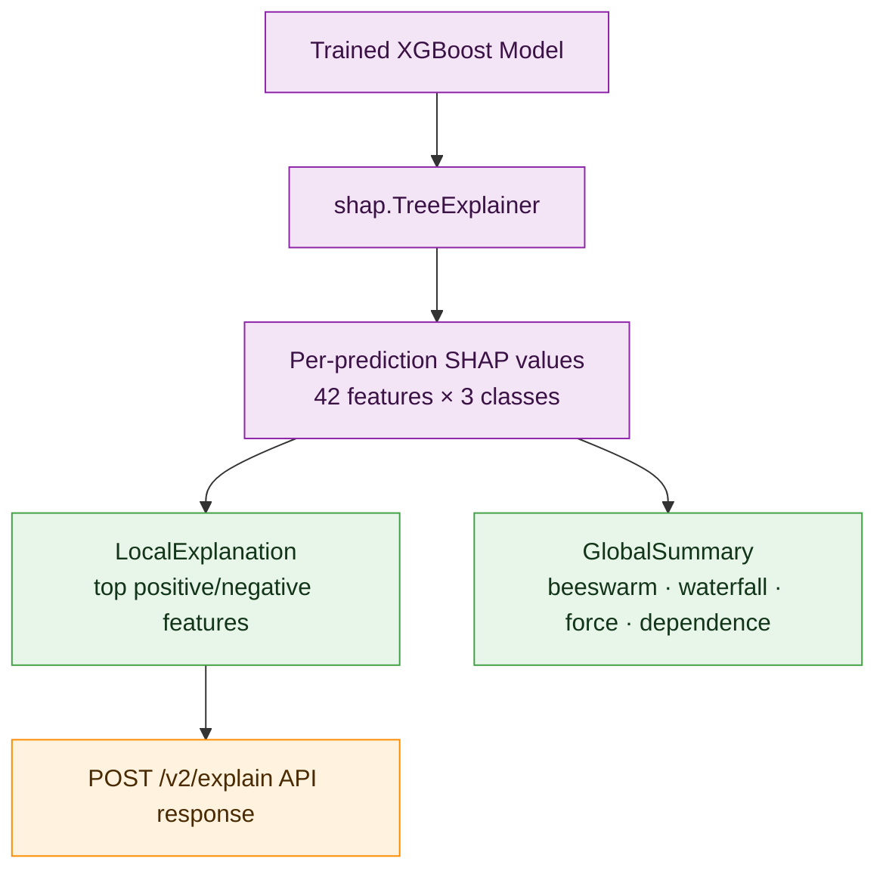
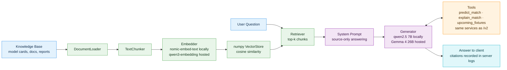

# Architecture and AI Pipelines

Current source guide for v2.6.0. Model and assistant evaluation figures below are dated runs, not fresh measurements. [Project overview](../README.md) · [API](api.md)

## AI Pipeline Overview

The `ai/` workspace is a single Python project (managed with [uv](https://github.com/astral-sh/uv)) that owns the entire ML lifecycle:

```mermaid
flowchart LR
    A[Raw CSV\nfootball-data.co.uk] --> B[Schema and season validation]
    B --> C[ProcessedMatch\n46,709 matches, 5 leagues]
    C --> D[FeatureRegistry\n9 generators, Kahn sort]
    D --> E[Feature Matrix\n42 features × 46,709 rows]
    E --> F[XGBoost Training\nseason-based split]
    F --> G[Model Registry\nJSON + git commit]

    classDef source fill:#E3F2FD,stroke:#1E88E5,color:#0D2A4A
    classDef data fill:#E8F5E9,stroke:#43A047,color:#12351A
    classDef model fill:#F3E5F5,stroke:#8E24AA,color:#3A1245
    class A source
    class B,C,D,E data
    class F,G model
```

Every transformation is a reproducible script — never a notebook. Raw data is immutable; nothing downstream ever overwrites a source file.

## Application Architecture

The system follows Clean Architecture with strict, one-directional layer dependencies:

| Layer | Responsibility |
|---|---|
| Domain | Entities, value objects, business rules |
| Application | Use cases, service interfaces, DTOs |
| Infrastructure | Database, external APIs, file I/O, ML models |
| Presentation | FastAPI routes, Compose UI, ViewModels |

The backend composes the inference, explainability, goals and assistant packages through service adapters. Evaluation scripts may also import backend services. The Android frontend uses MVVM: ViewModels own state as `StateFlow`; Composables are pure functions of state.

## Model Training Pipeline

Whole seasons are assigned to train, validation and test, so the frozen reporting model is evaluated on later seasons; see [ADR 007](adr/007-season-based-split-and-evaluation.md). 2024/25 and 2025/26 are held back as an out-of-time check. Hyperparameters are chosen by season cross-validation on training seasons only (`training.tuning`). Result on the 2023/24 test season across all five leagues: **52.5% accuracy, log loss 0.976** on a 3-class problem (random baseline: 33.3%; bookmakers 55.0% and 0.955). Details: [model comparison report](reports/multi-league-retraining-comparison.md).

**Two models, two jobs (ADR 017).** Those test figures come from the frozen-split model `20260928_123224`, trained on 2000/01–2021/22 only, so its test and holdout seasons stay unseen. The model the API serves, `20261007_154105`, is a refit of the same recipe on every season from 2000/01 to 2025/26 (46,709 matches): the same 42 pinned features and settings, a fixed 168 trees (the frozen run's best iteration) and no early stopping. It has no held-out season of its own, so it was checked on the 2026/27 matches played so far before it replaced the frozen model on 7 October 2026 (see [the refit report](reports/refit-all-seasons.md)). The frozen model stays in `models/runs/` as the reporting model and the rollback.

## Explainability Pipeline

Every prediction is explainable — not as an afterthought, but as a first-class API response. See [ADR 004](adr/004-shap-for-explainability.md) for why SHAP was chosen over LIME, native XGBoost importance, and Captum.

## Football Intelligence Assistant

The assistant is instructed, by system prompt, to answer **only** from retrieved context or tool results. Chunks scoring below the index's cut-off (0.81 for the local index, 0.77 for the hosted one) are dropped before generation, so low-scoring context is excluded and the prompt asks the model to abstain. This improves the measured abstention cases; it is not a general correctness guarantee. If the model provider is down, out of quota or too slow, `POST /assistant/chat` returns a structured `503` and predictions keep working.

**Two providers (ADR 025).** `ASSISTANT_PROVIDER` picks `ollama` (the default), `workers_ai` (Cloudflare Workers AI, for the hosted API) or `off`. Each index records the embedding model it was built with and its cut-off in `index.json`, and the server refuses an index built with a different model than its embedder, so local and hosted vectors are never mixed. Hosted calls have a timeout per attempt, may retry once, and log reported token counts and estimated cost.

**Tool calling (ADR 018).** For a match prediction, its explanation or a league's upcoming fixtures, the model calls `predict_match`, `explain_match` or `upcoming_fixtures`. These run the same services as `/v2/predict`, `/v2/explain` and `/v2/fixtures`, in-process, so the assistant can quote the served model's results. Numeric checks cover specific supported values; citations are logged and removed from the public response (ADR 029). The chat model must support tool calling; both defaults do.

**Season tools and router (ADR 021).** Two internal tools answer season questions: `team_matches` (results, head-to-head and the next meeting this season) and `league_table` (the table on any date; for a date still ahead, each remaining fixture is simulated 10,000 times with the goals model to give expected points, goals and clean sheets and the chance of finishing first, top four or bottom three). After any configured safety check, the rule-based season router reads the question: player and next-season questions get a fixed reply without the model, and table, results and derby questions get their tool calls decided in code, so the 7B model only writes the answer. Season eval (`evaluation.assistant_season`): **7 of 7**, against 3 of 7 without the router.

**Evaluation** (run locally on 7 October 2026 with `qwen2.5:7b-instruct`; both need Ollama and the trained model, so CI runs only their scoring tests):

- **Tool calling** (`evaluation.assistant_grounding`): **11 of 11** correct, against 1 of 11 without tools. That is ten upcoming fixtures across the five leagues, where the answer must quote the probability `/v2/predict` gives and no number the API didn't return, plus a team that doesn't exist, where it must not invent numbers.
- **Saying "I don't know"** (`evaluation.assistant_abstention`): **20 of 20**: 10 of 10 off-topic questions refused with the exact phrase and 10 of 10 answerable ones answered. This 7B model also scored 20 of 20 with the old, ineffective cut-off; the 0.81 cut-off matters most for smaller models.
- **Hosted model** (run 11 October 2026 against Workers AI with the hosted index; [report](reports/hosted-assistant-evals.md)): Gemma 4 26B with its reasoning off scored **11 of 11** and **20 of 20**, answering in about 3 s (14 s at most) for about $0.00015 an answer. Qwen3 30B and GLM 4.7 Flash each added one unsupported number.
- **Choosing the model (ADR 019):** `llama3.2` (3B, the previous default) scored 5 of 11 and 15 of 20, misquoting probabilities and refusing answerable questions; `qwen2.5:14b-instruct` matched the 7B model. The 7B model is the default as the smallest that passes both.
