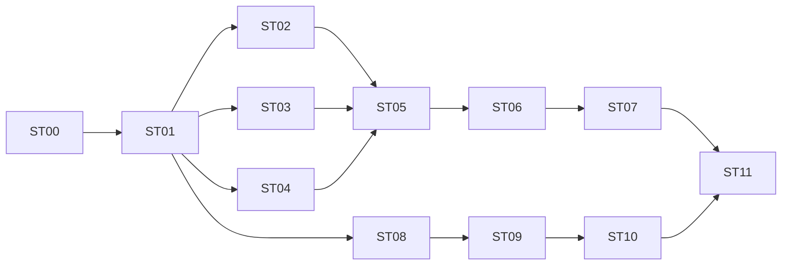

# Assistant streaming tracker

Status: Not started. Created 25 November 2026.
Design: [plan.md](plan.md). Contract both lanes build to: [contract.md](contract.md). How to run a step: [README.md](README.md). How to review one: [review.md](review.md).

One step is one prompt file in [`steps/`](steps/), one branch from `develop`, one PR into `develop`. A step is done only when its *Done when* holds, its PR is merged, and its evidence is linked below. The PR that does the step also updates its row and section here.

Status values: `Not started`, `In progress (PR #n)`, `Blocked (reason)`, `Done (date, PR #n)`.

| # | Step | Lane | Needs | Effort | Status |
|---|---|---|---|---|---|
| ST00 | [Spike: can every link stream?](steps/ST00-spike.md) | Spike | – | 0.5 d | Not started |
| ST01 | [ADR 037, API docs, telemetry 1.2.0](steps/ST01-adr-and-contract.md) | Contract | ST00 | 0.5 d | Not started |
| ST02 | [Split assistant_service.py](steps/ST02-split-assistant-service.md) | Backend | ST01 | 0.5 d | Not started |
| ST03 | [Streaming adapters](steps/ST03-streaming-adapters.md) | Backend | ST01 | 1–1.5 d | Not started |
| ST04 | [Stream gate](steps/ST04-stream-gate.md) | Backend | ST01 | 1 d | Not started |
| ST05 | [Streaming answers in the assistant](steps/ST05-assistant-stream.md) | Backend | ST02, ST03, ST04 | 1–1.5 d | Not started |
| ST06 | [Streaming endpoint](steps/ST06-endpoint.md) | Backend | ST05 | 1–1.5 d | Not started |
| ST07 | [Evals through the stream](steps/ST07-evals.md) | Backend | ST06 | 0.5–1 d | Not started |
| ST08 | [App network layer](steps/ST08-app-network.md) | Android | ST01 | 1 d | Not started |
| ST09 | [App repository and ViewModel](steps/ST09-app-viewmodel.md) | Android | ST08 | 1–1.5 d | Not started |
| ST10 | [App chat screen](steps/ST10-app-chat-screen.md) | Android | ST09 | 1–1.5 d | Not started |
| ST11 | [End to end, staging, release notes](steps/ST11-end-to-end-and-release.md) | Integration | ST07, ST10 | 1 d | Not started |
| | **Total** | | | **about 10–12.5 d** | |

## Order and parallel work

After ST01 merges, up to three threads can run at once: one on ST02 then ST05, one on ST03 then ST04 (or a third thread on ST04), and one on the Android lane (ST08 to ST10). Each parallel thread works in its own clone next to the main checkout, so branches never clash.

**File ownership** (a step edits only the files its prompt lists under *Files you own*):

| Area | Owned by |
|---|---|
| `ai/assistant/**` | ST02, ST03, ST04, ST05 (each names its files) |
| `ai/backend/**`, `ai/.env.example` | ST06 |
| `ai/evaluation/**` | ST07 |
| `frontend/core-model`, `frontend/core-network` | ST08 (ST09 only `ChatMessage` in `Chat.kt`) |
| `frontend/feature-assistant` | ST09, ST10 |
| `docs/api.md`, `docs/adr/`, `docs/observability/` | ST01 (ST06 only to correct, after raising it) |
| `contract.md`, `fixtures/` | Nobody: a change is its own docs PR first |
| This file | Every step, its own row and section only |

## How the two lanes fit together

The lanes never wait for each other because both test against the same files in [`fixtures/`](fixtures/): ST06 proves the server writes them byte for byte, and ST08 proves the app reads them. ST11 then runs the real app against the real server.

## Decisions log

| Date | Decision | Where |
|---|---|---|
| 2026-11-25 | Separate SSE endpoint under `/v2`; old endpoint unchanged; stream gate keeps citations and follow-up numbers back; Ktor stays 2.3.13 | [plan.md](plan.md) |

---

## ST00. Spike

- [ ] Ollama streams tool calls and usage
- [ ] Workers AI streams tool calls and usage
- [ ] Ktor Android engine hands over lines as they arrive; BODY logging holds them
- [ ] Cloud Run passes streams through
- [ ] FastAPI runs the generator's `finally` on disconnect

Evidence: `docs/reports/assistant-streaming-spike.md`.

## ST01. ADR 037, API docs, telemetry 1.2.0

- [ ] ADR 037 accepted
- [ ] `docs/api.md` section for the stream endpoint
- [ ] Telemetry contract 1.2.0 (`ttft_ms`, `streamed`, outcome `stopped`)

Evidence: PR link.

## ST02. Split assistant_service.py

- [ ] `turn.py` and `tool_runner.py`; `assistant_service.py` under 300 lines; tests unchanged

Evidence: PR link, line counts.

## ST03. Streaming adapters

- [ ] Ollama `chat_stream`
- [ ] Workers AI `chat_stream` with retry before the first piece only
- [ ] Early close closes upstream (tests)

Evidence: PR link, timestamped manual run.

## ST04. Stream gate

- [ ] Citations held back and removed
- [ ] Follow-up numbers checked before release
- [ ] Property test over every split point

Evidence: PR link.

## ST05. Streaming answers in the assistant

- [ ] `StreamingAnswerer` with every invariant tested
- [ ] `ttft_ms` and `streamed` on `assistant.answer`

Evidence: PR link, timestamped manual run.

## ST06. Streaming endpoint

- [ ] Six fixtures matched byte for byte
- [ ] Pre-checks before the stream; sign, charge and store once at `done`
- [ ] Disconnect charges and stores `stopped`
- [ ] Not on `/v1`; `ASSISTANT_STREAMING` switch

Evidence: PR link, `curl -N` transcript.

## ST07. Evals through the stream

- [ ] `--stream` on four eval CLIs
- [ ] Same pass counts streamed and not

Evidence: `docs/reports/assistant-streaming-evals.md`.

## ST08. App network layer

- [ ] `ChatStreamEvent`, `SseParser`, `chatStream`
- [ ] Every fixture parsed from the real file
- [ ] Stream URL excluded from BODY logging

Evidence: PR link.

## ST09. App repository and ViewModel

- [ ] Deltas, reset, done, failures, fallback, history rules (TDD)

Evidence: PR link, emulator note.

## ST10. App chat screen

- [ ] Typing dots, growing bubble, scroll, TalkBack, previews, strings

Evidence: PR link, screen recording.

## ST11. End to end, staging, release notes

- [ ] Ten end-to-end checks, local and staging
- [ ] Time to first word on staging in the README
- [ ] Roadmap, plan, changelog, release notes updated

Evidence: `docs/reports/assistant-streaming-e2e.md`.
