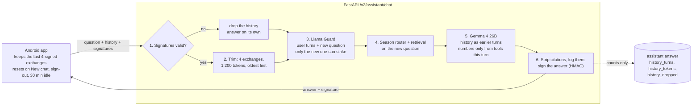

# Chat memory plan

Approved 15 October 2026 (recommended options). Decision record: [ADR 030](../adr/030-short-term-chat-memory.md). Hosting tracker step 3c. Ships in v2.5.0.

The assistant remembers the last 4 exchanges of a conversation. The phone keeps them and sends them with each question, and the server signs its own answers so a modified app can't forge history. Nothing new is stored on the server.

## How one turn works

## API contract (v2.5.0)

`POST /v2/assistant/chat` gains optional fields; requests without them work as before.

| Field | Where | Type | Rule |
|---|---|---|---|
| `conversation_id` | request | string, 8–64 chars | Made by the app; new on New chat, sign-out or 30 min idle |
| `history` | request | list of `{role, content, signature?}`, at most 8 items | Oldest first; `role` is `user` or `assistant`; an assistant item needs its `signature` |
| `signature` | response | string, 64 hex chars | HMAC-SHA256 over user, conversation ID and answer, keyed by `HISTORY_KEY` |

## Limits

| Limit | Value |
|---|---|
| Exchanges kept | 4 (8 messages) |
| History tokens | 1,200 (4 characters a token), oldest trimmed first |
| User turn | 1,000 characters (as today) |
| Assistant turn kept | 1,500 characters |
| Request body | 24 KB (was 16 KB) |
| Idle reset in the app | 30 minutes |

## Cost

Measured prices on Workers AI (15 October 2026): Gemma 4 26B about 0.009 neurons per input token; Llama Guard 3 about 0.044.

| Per answer | Neurons | Free answers a day |
|---|---|---|
| Today, no memory | 22 | about 450 |
| With memory, average over a 5-turn chat | 29 (+32%) | about 345 |
| Full window, with a tool round | 47 (+115%) | about 210 |

## Safety rails

| Risk | Rail |
|---|---|
| Fake assistant turns from a modified app | HMAC signature per answer; any bad signature drops the whole history |
| A harmful request split across turns | Llama Guard reads the user's recent turns together; only the newest question can strike |
| Prompt injection inside the history | History goes in as earlier turns below the system prompt, never as instructions |
| Old or worked-out numbers in a follow-up | Prompt rule plus a check in code: a follow-up answer with a number no tool returned this turn is asked again once |
| Oversized history | Trimmed, never rejected; 24 KB body limit |
| Privacy | Nothing stored; logs keep counts only; consent notice unchanged |

## Work, in order

1. ADR 030, this plan and the tracker step.
2. Backend: schemas, signing, trimming, Llama Guard over the conversation, the prompt rule, log fields, tests, `docs/api.md`, `HISTORY_KEY` in settings and the runbook.
3. `evaluation/assistant_conversation.py`: about 15 scripted chats; all four evals pass on Workers AI.
4. App (test-first): the ViewModel keeps the signed window, a New chat action, the 30-minute reset.
5. Release v2.5.0; deploy to staging with the `history-key` secret; watch `history_tokens` and neurons per answer.

The app also sends the user's favourite team with each question, so "we" and "my team" are understood ([ADR 031](../adr/031-favourite-team-in-chat.md)).
